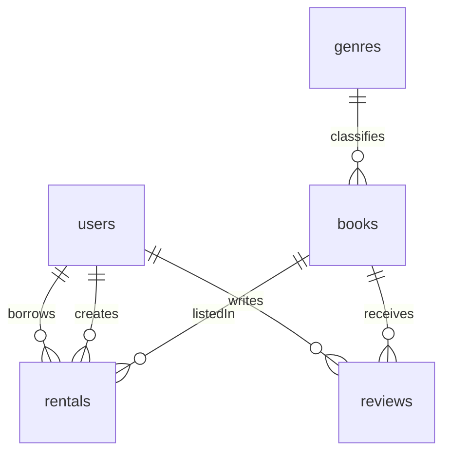

# Library database draft

This is the draft ERD for Milestone 1. There are five entities.

- A genre has many books.
- A user (the patron) has many rentals.
- A user (the staff member or admin who created the rental) has many rentals.
- A book has many rentals.
- A user has many reviews.
- A book has many reviews.
- One patron can review a book only once.

## Tables

**users:** id, first_name, last_name, email, phone, password_hash, role (admin, staff, or patron)

**genres:** id, name

**books:** id, title, author, isbn, publisher, publication_year, genre_id, total_copies, description

**rentals:** id, user_id, book_id, created_by, rented_at, due_date, returned_at, status (active, returned, or overdue)

**reviews:** id, user_id, book_id, rating, comment, created_at

Available copies are not stored. They are total_copies minus rentals that are active or overdue.
